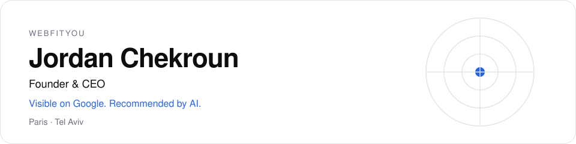

<div align="center">



[**webfityou.com**](https://webfityou.com) · [Blog](https://webfityou.com/blog)

</div>

<br>

## About

Former lawyer, now building search visibility for businesses. I moved into SEO in 2021, then focused my research on how generative engines choose what to cite, years before GEO became a topic.

WebFitYou brings the website, the content that search engines and AI understand, and the ad campaigns into one strategy, run by one team with one point of contact.

```typescript
export const jordan = {
  company: "WebFitYou",
  offices: ["Paris", "Tel Aviv"],
  languages: ["fr", "he", "en", "typescript"],
  principle: "AI speeds up the work. Decisions stay human.",
  motto: "It works… until it doesn't. Then I fix it, and automate the fix.",
};
```

<br>

## What we run


<br>

## The method


<br>

## How a project runs


<br>

## GEO: being recommended by AI

Generative Engine Optimization makes a brand understandable, citable and recommendable in AI answers. It complements Google SEO, it does not replace it.

- **Engines tracked:** ChatGPT, Gemini, Claude, Perplexity
- **Work:** map real prospect questions, strengthen proof and entities, structure extractable answers, deploy structured data, then track citations over time
- **Honest by design:** results vary by market, starting authority and competition. AI presence is observed, never guaranteed.

<br>

## AI agents and automation

Agents start from a goal, split the task, use company tools with limited rights, and a human validates before any sensitive action.

- n8n workflows and API integrations
- Custom MCP servers exposing CRM, calendar, catalog and billing to Claude or ChatGPT, with precise permissions
- CRM connected to data, with agents that qualify prospects and prepare follow-up
- AI training for professionals, by appointment, with confidentiality built in

<br>

## Team

Six specialist teams, one project lead: **SEO** · **GEO** · **Advertising** (Google Ads, Meta Ads, ChatGPT Ads) · **Design & Web** · **AI & CRM** · **Consulting & Training**.

Listed as an **Activateur France Num**, the French government network for the digital transformation of small businesses.

<br>

## Stack


<br>

## Projects

**[WebFitYou](https://webfityou.com)**
Digital agency. SEO, GEO, websites, paid media and AI automation, on one fixed-scope monthly subscription.

**Epiderme AI**
AI platform for aesthetic medicine practitioners.

<br>

## Read more

- [Client case studies](https://webfityou.com/realisations)
- [SEO, GEO and AI news for small businesses](https://webfityou.com/blog)
- [GEO optimization](https://webfityou.com/geo-optimization) · [ChatGPT Ads](https://webfityou.com/chatgpt-ads) · [AI training](https://webfityou.com/formation-ia)

<br>

<div align="center">

`exit 0`

</div>
