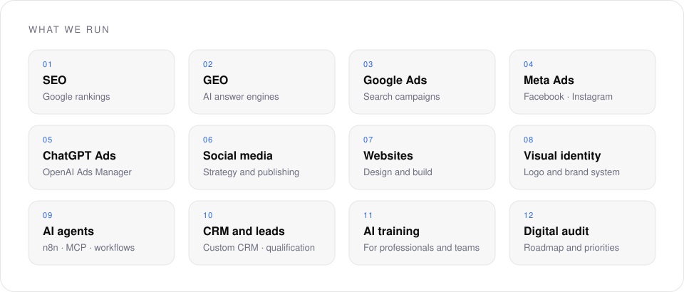
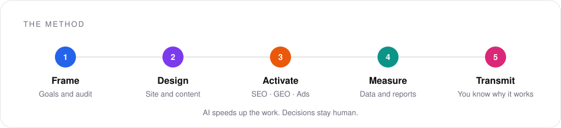
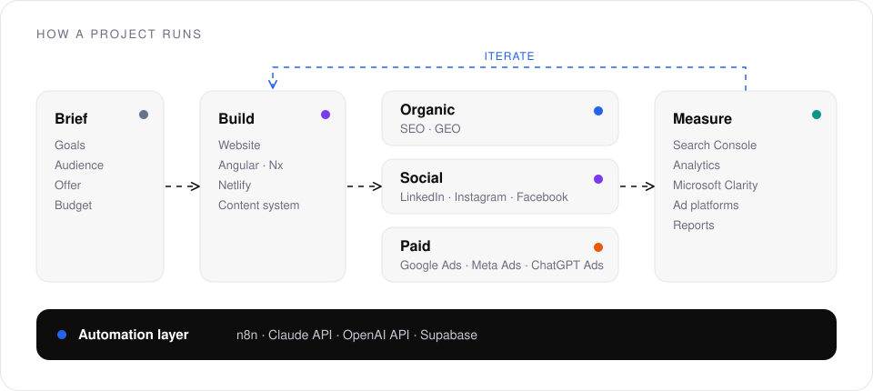
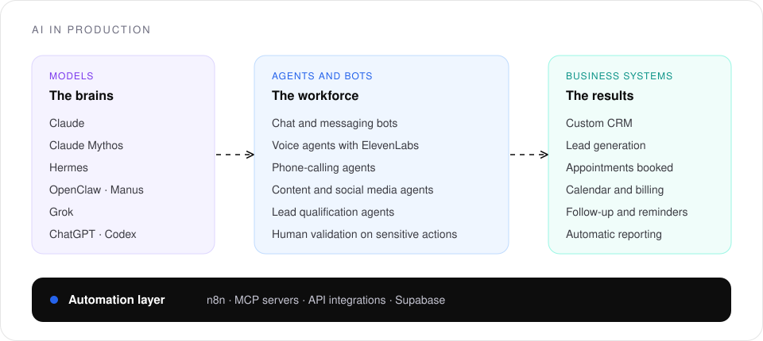

<div align="center">


**Architecture and development in Angular and TypeScript · n8n automation · AI agents · API integrations**

[LinkedIn](https://www.linkedin.com/in/chekroun-jordan-011aa1176/) · [contact@webfityou.com](mailto:contact@webfityou.com) · [webfityou.com](https://webfityou.com) · [Blog](https://webfityou.com/blog)

</div>

<br>

<div align="center">

<sub><b>NEW OPEN PROJECT</b></sub>

<h1>AGI-BOT Agency</h1>

<h3>Don't manage a list of AI agents. Walk into your company.</h3>

<a href="https://github.com/Jordanckn/agi-bot-agency"></a>


Answer three questions and your AI-run agency takes shape: an AI CEO, managers, agents,<br>offices, meetings and conversations. The organisation of large companies, within reach of small businesses.

<table>
<tr>
<td align="center" width="33%"><b>3 questions</b><br><sub>to design your organisation</sub></td>
<td align="center" width="33%"><b>9 languages</b><br><sub>for onboarding and tutorial</sub></td>
<td align="center" width="33%"><b>Runs locally</b><br><sub>on your own computer</sub></td>
</tr>
</table>

<a href="https://github.com/Jordanckn/agi-bot-agency"></a>
<a href="https://github.com/Jordanckn/agi-bot-agency"></a>

<br>

<a href="https://github.com/Jordanckn/agi-bot-agency"></a>
<a href="https://docs.openclaw.ai"></a>

</div>

<br>

## About

I design and build the technical side of digital growth: Angular and TypeScript applications, n8n automation, AI agents and API integrations. As founder of WebFitYou, I have supported **30+ clients** across SEO, GEO, websites, paid media and AI automation.

WebFitYou brings the website, the content that search engines and AI understand, and the ad campaigns into one strategy, run by one team with one point of contact.

**In one line:** I run search visibility (SEO, GEO), paid media (Google Ads, Meta Ads, ChatGPT Ads), social media and websites, and the AI layer behind them: agents and bots on Claude, Mythos, Hermes, OpenClaw and Grok, ElevenLabs voices, phone-calling agents, CRM and lead generation.

### Path

1. **Lawyer by training:** rigor, structure, and a habit of reading the fine print.
2. **SEO specialist:** search visibility, then research on how generative engines choose what to cite.
3. **Founder and AI developer:** WebFitYou, with code, automation and agents in production.

```typescript
export const jordan = {
  company: "WebFitYou",
  role: "Founder, developer, automation and AI agents",
  clientsSupported: "30+",
  offices: ["Paris", "Tel Aviv"],
  languages: ["fr", "he", "en", "typescript"],
  principle: "AI speeds up the work. Decisions stay human.",
  motto: "It works… until it doesn't. Then I fix it, and automate the fix.",
};
```

<br>

## What we run



<br>

## The method



<br>

## How a project runs



**Measurement:** Google Search Console, Google Analytics, Microsoft Clarity and the ad platforms, summed up in regular reports.

<br>

## GEO: being recommended by AI

Generative Engine Optimization makes a brand understandable, citable and recommendable in AI answers. It complements Google SEO, it does not replace it.

- **Engines tracked:** ChatGPT, Gemini, Claude, Perplexity
- **Work:** map real prospect questions, strengthen proof and entities, structure extractable answers, deploy structured data, then track citations over time
- **Honest by design:** results vary by market, starting authority and competition. AI presence is observed, never guaranteed.

<br>

## AI agents, voice and CRM



Agents start from a goal, split the task, use company tools with limited rights, and a human validates before any sensitive action.

- **Models and agents:** I set up and run Claude, Claude Mythos, Hermes, OpenClaw and Grok bots for business use
- **Voice:** ElevenLabs voices and voice agents
- **Phone:** AI phone-calling agents that answer, qualify and book appointments
- **CRM and leads:** custom CRM connected to your data, lead sourcing, enrichment and qualification, follow-up prepared by agents
- **Automation:** n8n workflows and API integrations, plus custom MCP servers exposing CRM, calendar, catalog and billing to Claude or ChatGPT, with precise permissions
- **Training:** AI training for professionals, by appointment, with confidentiality built in

<br>

## Team

Six specialist teams, one project lead: **SEO** · **GEO** · **Advertising** (Google Ads, Meta Ads, ChatGPT Ads) · **Design & Web** · **AI & CRM** · **Consulting & Training**.

Listed as an **Activateur France Num**, the French government network for the digital transformation of small businesses.

<br>

## Tools

**AI models and agents**

<p>
  
  
  
  
  
  
  
  
  
</p>

**AI engines I optimize for (GEO)**

<p>
  
  
  
  
  
  
</p>

**Voice, automation and data**

<p>
  
  
  
  
</p>

**Ads, analytics and SEO**

<p>
  
  
  
  
  
  
  
</p>

**Web and infrastructure**

<p>
  
  
  
  
  
  
  
  
</p>

<br>

## Projects

**[AGI-BOT Agency](https://github.com/Jordanckn/agi-bot-agency)**
Immersive, local dashboard that turns OpenClaw agents into an AI-run agency.

**[WebFitYou](https://webfityou.com)**
Digital agency. SEO, GEO, websites, paid media and AI automation, on one fixed-scope monthly subscription.

**Epiderme AI**
AI platform for aesthetic medicine practitioners.

<br>

## Read more

- [Client case studies](https://webfityou.com/realisations)
- [SEO, GEO and AI news for small businesses](https://webfityou.com/blog)
- [GEO optimization](https://webfityou.com/geo-optimization) · [ChatGPT Ads](https://webfityou.com/chatgpt-ads) · [AI training](https://webfityou.com/formation-ia)

<br>

## Contact

[LinkedIn](https://www.linkedin.com/in/chekroun-jordan-011aa1176/) · [contact@webfityou.com](mailto:contact@webfityou.com) · [Contact page](https://webfityou.com/contact)

<br>

<div align="center">

`exit 0`

</div>
